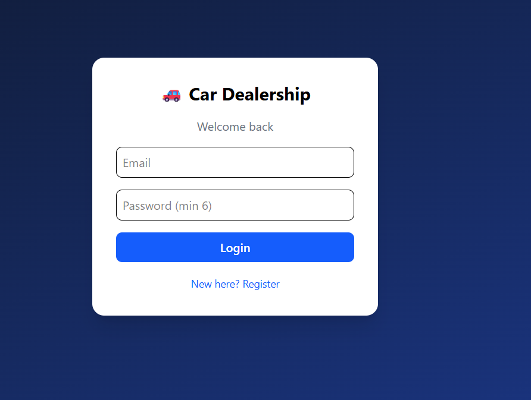
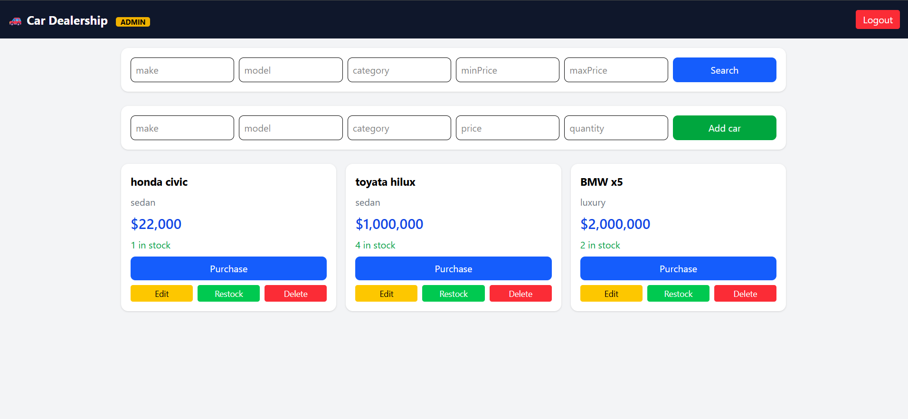
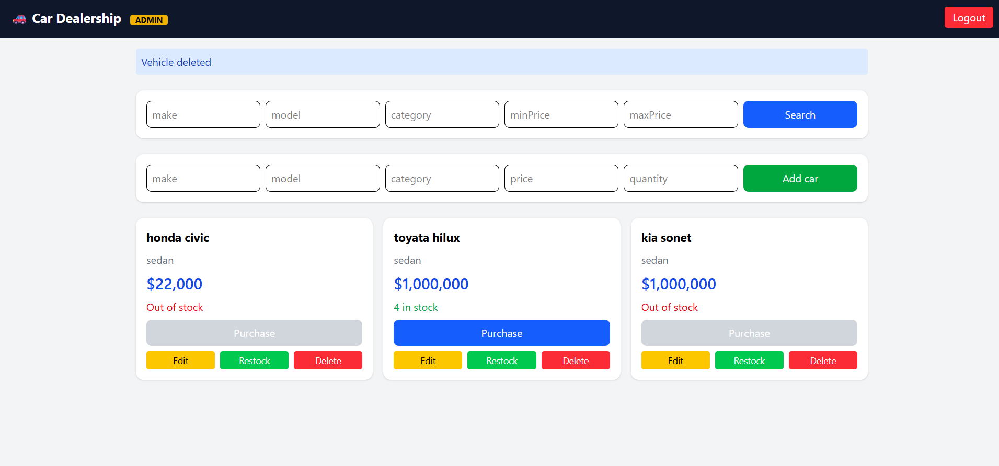
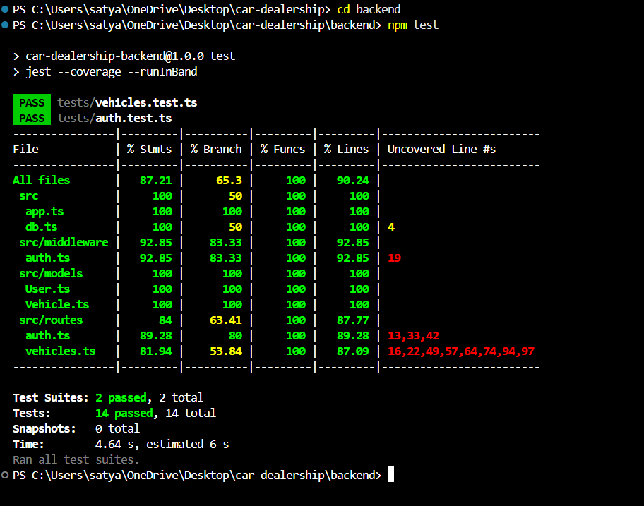

# Car Dealership Inventory System

A full-stack app to manage a car dealership's inventory. Users register and log in,
browse and search vehicles, and purchase them. Admins can also add, update, delete and restock vehicles.

## Tech stack
- **Backend:** Node.js, Express, TypeScript, MongoDB (Mongoose), JWT, bcrypt
- **Frontend:** React (Vite), Tailwind CSS, HTML5, CSS3
- **Tests:** Jest and Supertest

## Setup

### 1. Start MongoDB (Docker)
Run the official `mongo` image with host port `27017`.

### 2. Backend
```
cd backend
npm install
npm start
```
Runs on http://localhost:3000

### 3. Frontend
```
cd frontend
npm install
npm run dev
```
Open http://localhost:5173

### 4. Run the tests
```
cd backend
npm test
```
Tests use a separate database, `car_dealership_test`.

## API endpoints
| Method | Endpoint | Access |
|---|---|---|
| POST | /api/auth/register | Public |
| POST | /api/auth/login | Public |
| POST | /api/vehicles | Logged in |
| GET | /api/vehicles | Logged in |
| GET | /api/vehicles/search | Logged in |
| PUT | /api/vehicles/:id | Logged in |
| DELETE | /api/vehicles/:id | Admin only |
| POST | /api/vehicles/:id/purchase | Logged in |
| POST | /api/vehicles/:id/restock | Admin only |

## Screenshots




## Test report
14 tests passed across 2 test suites.



## Known limitations
- For demo purposes, anyone can register as admin using a checkbox. A real app
  would not allow this.


## My AI Usage

**AI Tool Used:** Claude (Anthropic)

### How I Used AI

I used Claude as a development assistant to streamline implementation, improve development efficiency, and accelerate the development workflow while maintaining control over the application's design and technical decisions.

- **Project Setup and Architecture:** Used Claude to assist with configuring Node.js, MongoDB with Docker, TypeScript, Jest, and Git, and to validate the overall project structure and development workflow.
- **Backend Development:** Leveraged Claude to accelerate the implementation of authentication routes, JWT middleware, vehicle management APIs, and request validation, while reviewing the code and ensuring it aligned with the application's requirements.
- **Frontend Development:** Used Claude to assist with React component implementation and API integration, focusing on maintainable components and a consistent user experience.
- **Test-Driven Development:** Used Claude to help develop Jest test cases and identify edge cases. Followed the Red-Green-Refactor approach by running tests before implementation, validating the results, and refining the code.
- **Debugging and Problem Solving:** Used Claude to investigate and resolve development issues, including incorrect Git repository initialization, file-name casing inconsistencies on Windows, and invalid JWT errors during frontend-backend integration.
- **Code Review and Productivity:** Used Claude to review implementation approaches, identify potential improvements, and reduce repetitive coding effort, allowing more time to focus on application logic, testing, and integration.

### Reflection on AI Usage
**Reflection:** Claude helped me speed up development by simplifying repetitive coding tasks, debugging issues, and improving the testing workflow. I used it as a development assistant while making technical decisions, reviewing the generated code, and validating the implementation through tests. Working on this project strengthened my understanding of REST APIs, JWT authentication, database integration, and protected routes. In future projects, I would write more tests independently before implementation and use AI mainly for code review, debugging, and improving efficiency.

The full chat logs are in `PROMPTS.md`.
